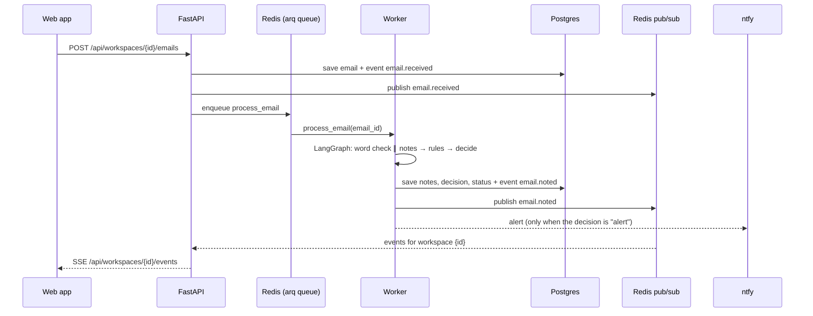
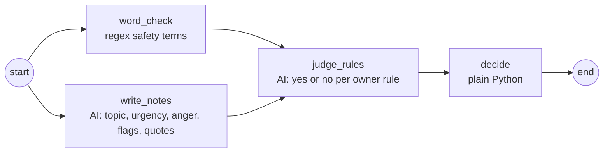

# Herald: Architecture

Herald is one monorepo with a SvelteKit front end, a FastAPI back end with a separate pipeline worker, and a core package that holds the LangGraph pipeline. No code in it knows about any one business.

## Repo layout

| Path | What it is | Tooling |
| --- | --- | --- |
| `packages/core` | `herald_core`: shared types, safety-floor word check, decide step, LangGraph graph, AI model adapters, plug-in interfaces. No database and no Redis. | uv, pytest |
| `apps/server` | `herald_server`: the FastAPI API (`herald_server.api.main:app`) and the arq worker (`herald_server.worker.main.WorkerSettings`). They share the tables, event bus and pipeline. | uv, FastAPI CLI, arq |
| `apps/web` | SvelteKit (Svelte 5, runes) built as a static single-page app. API types are generated from FastAPI's OpenAPI schema. | pnpm, Vite, svelte-check, Vitest |
| `docs` | Scope, decisions and this file | — |

The Python packages form one uv workspace (root `pyproject.toml`). The JS app is in a pnpm workspace (root `pnpm-workspace.yaml`). The `Makefile` runs both.

## How an email flows

## The pipeline

- The graph is compiled once and shared by all tenants. Each run carries its workspace's config in the state.
- `word_check` and `write_notes` run in parallel and write different state keys.
- If the AI fails (outage, refusal, bad output), the notes are empty and the email goes to "Needs a look". A safety-floor match from the word check still alerts.
- `decide` order, first match wins: safety floor → owner rules (alert beats close) → urgent or anger 5 → anger 4 from an important contact, or about to cancel → unsure → spam → inbox.

## Status

The AI writes notes and never sets status. Status changes in two places only: the decide step (`new` → `alerted`, `needs_a_look`, `inbox` or `closed`) and the owner's actions:

| Action | From | To | Side effect |
| --- | --- | --- | --- |
| On it | any | `in_progress` | — |
| Not urgent | `alerted` only | `inbox` | A correction is saved |
| Done | any | `done` | — |

## Live events (SSE)

- `GET /api/workspaces/{id}/events` streams `email.received`, `email.noted`, `email.status` and `alert.sent`.
- Each event is stored in the `event` table first, then published to Redis channel `herald:ws:{id}`. A tab only hears its own workspace.
- The browser's `EventSource` reconnects on its own and sends `Last-Event-ID`. The server replays missed events from the database.
- FastAPI sends a keep-alive comment every 15 s.
- SSE runs one way only. Owner actions are plain POSTs.
- Auth is not built yet. When it lands it must be a cookie, because `EventSource` cannot send an `Authorization` header.

## Multi-tenancy

- Every tenant-owned row has `workspace_id`, and every query filters on it. A test checks that one workspace cannot read another's emails.
- Each business is a `WorkspaceConfig`: profile, topics, important contacts, owner guidance and rules. Tripfold is seed data in `herald_server/seed.py`.
- A business is added in one of two ways. One is the setup flow: `POST /api/workspaces/setup` takes a name and description, and the AI drafts topics, guidance and rules (`herald_server/setup.py`). The owner edits the draft and saves it with `PUT /api/workspaces/{id}/config`. The other is a full config posted to `POST /api/workspaces`.
- A workspace stays a draft (`setup_done = false`) until its setup is saved. A draft workspace refuses email with `409`, because its config is the AI's unchecked guess.
- Owner guidance goes into the notes prompt, after the static instructions. It shapes topic, urgency and anger only. The prompt says it cannot silence the safety floor, and the word check runs regardless. Routing stays with rules.
- Planned: per-workspace caps on AI calls and emails per day.

## Plug-in points

| Interface | Where | Built-in implementations |
| --- | --- | --- |
| `TriageModel` | `herald_core.model` | `AnthropicModel` (Claude, structured outputs), `FakeModel` (offline keyword heuristics) |
| `Notifier` | `herald_core.adapters` | `NtfyNotifier`, `LogNotifier` |
| `EmailSource` | `herald_core.adapters` | None yet. The test-email box posts to the API. |
| `EventBus` | `herald_server.bus` | `RedisEventBus`, `InMemoryEventBus` |
| `JobQueue` | `herald_server.queue` | `ArqQueue`, `InlineQueue` |

## Configuration

Settings are read from `HERALD_*` environment variables or `.env` (see `.env.example`).

| Variable | Default | Lite mode (`make lite`) |
| --- | --- | --- |
| `HERALD_DATABASE_URL` | Postgres on localhost | SQLite file |
| `HERALD_BUS` | `redis` | `memory` |
| `HERALD_QUEUE` | `arq` | `inline` |
| `HERALD_MODEL_PROVIDER` | `fake` | `fake` |
| `HERALD_NTFY_TOPIC` | unset (alerts are logged) | unset |

## Not built yet

- Alembic migrations (tables are created on startup for now)
- Auth and per-workspace limits
- A settings page for editing a workspace after setup (`PUT /config` is ready for it)
- The rule test, the score report and the test-email set
- Refusal fallbacks for the Claude model (a refusal currently routes the email to "Needs a look")
