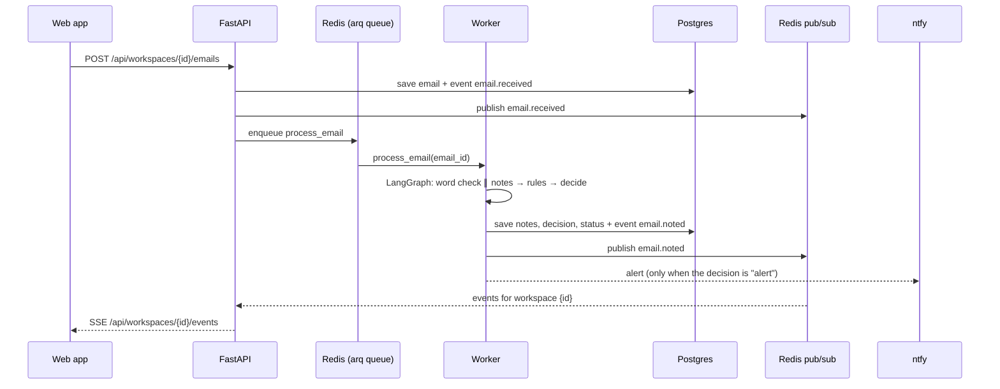
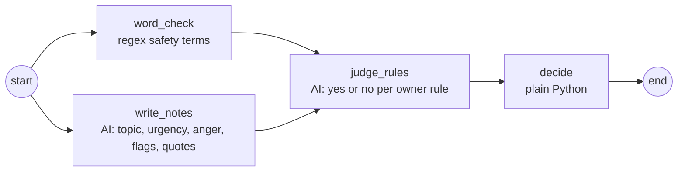

# Herald: Architecture

Herald is one monorepo with a SvelteKit front end, a FastAPI back end with a separate pipeline worker, and a core package that holds the LangGraph pipeline. No code in it knows about any one business.

## Repo layout

| Path | What it is | Tooling |
| --- | --- | --- |
| `packages/core` | `herald_core`: shared types, safety-floor word check, decide step, LangGraph graph, AI model adapters, plug-in interfaces. No database and no Redis. | uv, pytest |
| `apps/server` | `herald_server`: the FastAPI API (`herald_server.api.main:app`) and the arq worker (`herald_server.worker.main.WorkerSettings`). They share the tables, event bus and pipeline. | uv, FastAPI CLI, arq |
| `apps/web` | SvelteKit (Svelte 5, runes) built as a static single-page app. API types are generated from FastAPI's OpenAPI schema. | pnpm, Vite, svelte-check, Vitest |
| `docs` | Scope, decisions and this file | — |

The Python packages form one uv workspace (root `pyproject.toml`). The JS app is in a pnpm workspace (root `pnpm-workspace.yaml`). The `Makefile` runs both.

## How an email flows

## The pipeline

- The graph is compiled once and shared by all tenants. Each run carries its workspace's config in the state.
- `word_check` and `write_notes` run in parallel and write different state keys.
- If the AI fails (outage, refusal, bad output), the notes are empty and the email goes to "Needs a look". A safety-floor match from the word check still alerts.
- `decide` order, first match wins: safety floor → owner rules (alert beats close) → urgent or anger 5 → anger 4 from an important contact, or about to cancel → unsure → spam → inbox.

## Status

The AI writes notes and never sets status. Status changes in two places only: the decide step (`new` → `alerted`, `needs_a_look`, `inbox` or `closed`) and the owner's actions:

| Action | From | To | Side effect |
| --- | --- | --- | --- |
| On it | any | `in_progress` | — |
| Not urgent | `alerted` only | `inbox` | A correction is saved |
| Done | any | `done` | — |

## Live events (SSE)

- `GET /api/workspaces/{id}/events` streams `email.received`, `email.noted`, `email.status`, `mailbox.status` and `alert.sent`.
- Each event is stored in the `event` table first, then published to Redis channel `herald:ws:{id}`. A tab only hears its own workspace.
- The browser's `EventSource` reconnects on its own and sends `Last-Event-ID`. The server replays missed events from the database.
- FastAPI sends a keep-alive comment every 15 s.
- SSE runs one way only. Owner actions are plain POSTs.
- Auth is not built yet. When it lands it must be a cookie, because `EventSource` cannot send an `Authorization` header.

## Multi-tenancy

- Every tenant-owned row has `workspace_id`, and every query filters on it. A test checks that one workspace cannot read another's emails.
- Each business is a `WorkspaceConfig`: profile, topics, important contacts and rules. Tripfold is seed data in `herald_server/seed.py`.
- Planned: per-workspace caps on AI calls and emails per day.

## Mail connectors

A connector reads one kind of mailbox (Gmail first; Outlook and IMAP later). One `Mailbox` table, one sync job and one set of routes serve every provider. Only code in `herald_server/connectors/<provider>/` knows a provider. Everywhere else the cursor and `provider_state` are opaque, and code finds the connector with `services.connectors[mailbox.provider]`.

### How synced mail flows

- The first sync (no cursor) reads the last 2 days of inbox mail, at most 50 messages. The cursor is the profile `historyId`, read before the list, so mail that lands during the sync is read by the next one. The same path runs when Gmail no longer has the cursor's history (about a week).
- Later syncs read the history since the cursor. The new cursor is the `historyId` of the first page, so a re-read is possible but a loss is not. Stored mail is deduped on `(mailbox_id, provider_message_id)`.
- A mail that cannot be parsed is skipped, so one bad email cannot block the mailbox.
- Only inbox mail is read. Sent mail and drafts are skipped. The scope is `gmail.readonly`.
- Credentials are encrypted with `HERALD_TOKEN_KEY` and never leave the server. The OAuth `state` is signed with the same key and expires after 10 minutes.
- Push is verified: the Pub/Sub JWT must match the audience and service account in the settings. A bad signature gets 401. A good push for an unknown or inactive address gets 204, so Pub/Sub does not retry it.

### Sync job

`sync_mailbox_job` uses a pending flag and a lock, not fixed job ids.

- Every job first sets the flag `herald:sync-pending:{mailbox_id}`.
- One job at a time per mailbox holds the Redis lock `herald:sync:{mailbox_id}`. Any other job sees the lock busy and returns, because the flag is already set.
- The lock holder loops while the flag is set: clear the flag, sync, enqueue `process_email` for each new email. A push that arrives during a sync sets the flag again.
- The loop stops after 120 s. After the lock is released, a leftover flag starts a fresh job.
- A rate limit from the provider retries the job (at least 5 s later, up to 5 tries). The cursor does not move, so the retry reads the same changes.
- A pause or disconnect that races a sync wins: a mailbox that is not `active` is not synced, and the sync never overwrites that status.

### Mailbox status

| Status | Meaning | Moves out by |
| --- | --- | --- |
| `active` | Syncing and receiving push | Owner pauses, access is revoked, or owner disconnects |
| `paused` | Owner stopped it. Push is off, the cursor is kept. | Owner resumes (a catch-up sync runs) |
| `needs_reauth` | The owner revoked access, or the stored credentials no longer decrypt (for example the key changed). Only an `active` mailbox moves here. | Owner connects again; the same row is reused |
| `disconnected` | Credentials are deleted and the grant is revoked. Stored emails are kept. | Owner connects again |

Every change saves a `mailbox.status` event in the same transaction, then publishes it to the live events stream.

### Routes

| Route | What it does |
| --- | --- |
| `GET /api/workspaces/{id}/mailboxes` | List mailboxes. No credential fields. |
| `POST /api/workspaces/{id}/mailboxes/{provider}/connect` | Returns the provider's `authorization_url` |
| `GET /api/oauth/{provider}/callback` | Finishes the connect, then redirects to the web app |
| `POST /api/workspaces/{id}/mailboxes/{mailbox_id}/sync` | Queue a sync now (202). 409 unless `active`. |
| `POST .../pause`, `POST .../resume`, `DELETE .../{mailbox_id}` | Owner actions. 409 when the status does not allow it. |
| `POST /api/webhooks/{provider}` | Provider push. Verified by the connector. |

The OAuth callback always redirects to `HERALD_WEB_URL` with one query value:

| Query | Meaning |
| --- | --- |
| `mailbox_connected=<id>` | The mailbox is connected and its first sync is queued |
| `mailbox_error=access_denied` | The owner refused at the provider |
| `mailbox_error=provider_unavailable` | The provider is not set up, or `HERALD_TOKEN_KEY` is not set |
| `mailbox_error=invalid_state` | The state is bad, expired, for another provider, or names a missing workspace |
| `mailbox_error=authorization_failed` | No code came back, or the provider refused the code |
| `mailbox_error=no_refresh_token` | The provider gave no long-lived credential |

### Cron jobs

| Job | When | What it does |
| --- | --- | --- |
| `renew_subscriptions_job` | Daily at 03:00 | Renews push for every active mailbox. A Gmail watch lasts 7 days. A revoked grant moves the mailbox to `needs_reauth`. |
| `catch_up_syncs_job` | Every 15 minutes | Queues a sync for every active mailbox, to pick up mail whose push was lost |

Both jobs run across all workspaces on purpose.

Google Cloud setup (consent screen, OAuth client, Pub/Sub topic and push subscription) is a manual step. It is described in the mail connectors plan.

## Plug-in points

| Interface | Where | Built-in implementations |
| --- | --- | --- |
| `TriageModel` | `herald_core.model` | `AnthropicModel` (Claude, structured outputs), `FakeModel` (offline keyword heuristics) |
| `Notifier` | `herald_core.adapters` | `NtfyNotifier`, `LogNotifier` |
| `MailConnector` | `herald_server.connectors` | `GmailConnector`; `FakeConnector` in tests. The test-email box still posts to the API. |
| `EventBus` | `herald_server.bus` | `RedisEventBus`, `InMemoryEventBus` |
| `JobQueue` | `herald_server.queue` | `ArqQueue`, `InlineQueue` |

## Configuration

Settings are read from `HERALD_*` environment variables or `.env` (see `.env.example`).

| Variable | Default | Lite mode (`make lite`) |
| --- | --- | --- |
| `HERALD_DATABASE_URL` | Postgres on localhost | SQLite file |
| `HERALD_BUS` | `redis` | `memory` |
| `HERALD_QUEUE` | `arq` | `inline` |
| `HERALD_MODEL_PROVIDER` | `fake` | `fake` |
| `HERALD_NTFY_TOPIC` | unset (alerts are logged) | unset |
| `HERALD_TOKEN_KEY` | unset (Gmail off: it needs this, the Google client id and secret, and the topic) | unset |
| `HERALD_PUBLIC_API_URL` | `http://localhost:8000` | same |
| `HERALD_WEB_URL` | `http://localhost:5173` | same |
| `HERALD_GOOGLE_CLIENT_ID`, `HERALD_GOOGLE_CLIENT_SECRET` | unset (Gmail off, as above) | unset |
| `HERALD_GMAIL_TOPIC` | unset (Gmail off: no mailbox can be connected) | unset |
| `HERALD_GMAIL_PUSH_AUDIENCE`, `HERALD_GMAIL_PUSH_SERVICE_ACCOUNT` | unset (every push is rejected) | unset |

## Not built yet

- Alembic migrations (tables are created on startup for now)
- Auth and per-workspace limits
- The rule test, the score report and the test-email set
- An Outlook connector, and IMAP
- Filter-based watch labels (Gmail watches the whole inbox)
- Binding the OAuth `state` to the browser that started the connect. It needs auth or a state cookie.
- A sweeper for emails left `new` when a sync fails after its commit
- Refusal fallbacks for the Claude model (a refusal currently routes the email to "Needs a look")
