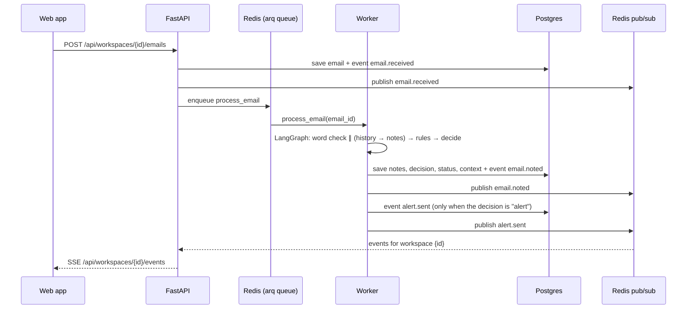
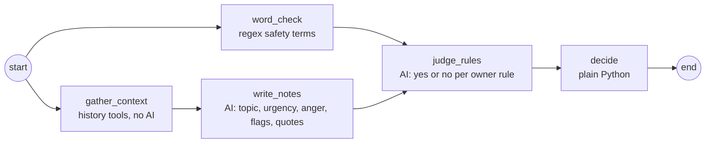
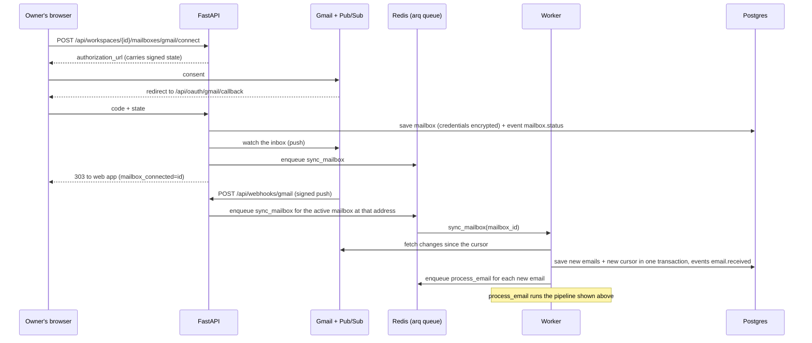

# Herald: Architecture

Herald is one monorepo with a SvelteKit front end, a FastAPI back end with a separate pipeline worker, and a core package that holds the LangGraph pipeline. No code in it knows about any one business.

## Repo layout

| Path | What it is | Tooling |
| --- | --- | --- |
| `packages/core` | `herald_core`: shared types, safety-floor word check, decide step, LangGraph graph, AI model adapters, plug-in interfaces. No database and no Redis. | uv, pytest |
| `apps/server` | `herald_server`: the FastAPI API (`herald_server.api.main:app`) and the arq worker (`herald_server.worker.main.WorkerSettings`). They share the tables, event bus and pipeline. | uv, FastAPI CLI, arq |
| `packages/evals` | `herald_evals`: test emails with known answers, run through the real graph, and the score report. See [evals.md](evals.md). | uv, pytest |
| `apps/web` | SvelteKit (Svelte 5, runes) built as a static single-page app. API types are generated from FastAPI's OpenAPI schema. | pnpm, Vite, svelte-check, Vitest |
| `docs` | Scope, decisions and this file | — |

The Python packages form one uv workspace (root `pyproject.toml`). The JS app is in a pnpm workspace (root `pnpm-workspace.yaml`). The `Makefile` runs both.

## How an email flows

## The pipeline

- The graph is compiled once and shared by all tenants. Each run carries its workspace's config in the state.
- `word_check` and `write_notes` run in parallel and write different state keys.
- `write_notes` waits on `gather_context`. `word_check` does not.
- If the AI fails (outage, refusal, bad output), the notes are empty and the email goes to "Needs a look". A safety-floor match from the word check still alerts.
- `decide` order, first match wins: safety floor → not for the business → owner rules (alert beats close) → urgent or anger 5 → anger 4 from an important contact, or about to cancel → unsure → spam → inbox.
- "Not for the business" means the AI filed the email under "Spam or not for me", is sure, and the sender is not an important contact. That mail closes before the rules and defaults, so a promotion that reads as urgent or names a rule's words stays quiet. `judge_rules` skips it, which saves one model call. Unsure spam and spam from an important contact take the normal path. The safety floor still comes first.

## History

Before the model reads an email, `gather_context` runs three tools in code: `sender_history` (recent emails from the same sender), `thread` (earlier messages in the thread) and `recent_corrections` (emails the owner moved to the inbox from an alert or from closed). This is a pre-fetch, not a model loop. The tools read Herald's own database, never the mail provider.

- The workspace is bound when the toolbox is built. No tool input has a workspace or email id.
- A tool sees only emails received before the current one.
- A tool that fails or takes over 2 s gives nothing, and its name goes into `email.context.failed`. Triage goes on.
- `word_check` never waits on the tools. A slow tool can delay the alert by at most the tool timeout (2 s).
- History goes into the user message inside a fenced `<history>` block. Its text is untrusted, so Herald strips `<history>`, `<message>`, `<email>` and `<business>` tags from it.
- `email.context` saves what the model saw: repeat counts, the ids it was shown, failed tools and timings.

## The prompt

Claude gets one system prompt for each business and one user message for each email. `herald_core/prompt.py` builds both. `write_notes` and `judge_rules` send the same system prompt, so they share one cache entry. Each call's output schema decides what Claude answers.

| Layer | Changes when | Where it goes |
| --- | --- | --- |
| Herald: role, scales, flag definitions, fences | A Herald release | System prompt, first, from `triage.md` |
| Brand: name, profile, topics, facts, guidance, rules | The owner edits setup | System prompt, in `<business>` |
| History: sender history, thread, past corrections | Every email | User message, in `<history>`, before `<email>` |
| Email: sender, important marker, subject, body | Every email | User message, in `<email>` |

Building rules:

- The order is fixed: Name, Profile, Topics, Facts, Guidance, Rules. The order is part of the cache key, so it must not depend on the data.
- An empty section is left out, heading and all. Claude never sees an empty list.
- A topic is `- Name: meaning`. A topic without a meaning is a bare label.
- List items stay on one line. Inner whitespace collapses, so an owner's line cannot start a fake section such as `Rules:`.
- Rules are written as `- id=<id>: <when>`. The rule's name and action are not shown. Claude judges the condition only and does not know which rules alert.
- The "(important contact)" marker on the email comes from code, with `WorkspaceConfig.is_important`. The contact list never goes into the prompt.
- The brand name comes from `Workspace.name`. The pipeline passes it with the config.
- Facts say what is true. Guidance says how to judge. Setup drafts facts only from the owner's description.
- The setup does not cover every case. For an email nothing covers, Claude judges it as the owner would from the facts, guidance and rules, and that goes into the notes (topic, urgency, summary). A rule verdict stays on what the rule's condition means: an email that is only like a rule's case is a no. When Claude cannot tell how the owner would want it, it sets `sure` to false and the email goes to "needs a look". It also writes `question` (the one thing the owner could answer to settle it) and, when one plain fact would settle it, `fact_draft`. A sure note never carries either. The owner answers in the inbox by saving a fact, which re-reads the email (see Status).

To change the general instructions, edit `packages/core/src/herald_core/prompts/triage.md`. It has no placeholders. It is read once at import, so a missing file stops the API and worker from starting. Tests check that it names every urgency, every risk flag and the spam topic.

## Status

The AI writes notes and never sets status. Status changes in two places only: the decide step (`new` → `alerted`, `needs_a_look`, `inbox` or `closed`) and the owner's actions:

| Action | From | To | Side effect |
| --- | --- | --- | --- |
| On it | any | `in_progress` | — |
| Not urgent | `alerted` only | `inbox` | A correction is saved |
| Move to Inbox | `closed` only | `inbox` | A correction is saved |
| Done | any | `done` | — |
| Send and mark done | any but `done` | `done` | Only when the reply is `sent` |
| Re-read | `alerted`, `needs_a_look`, `inbox` or `closed` | whatever decide says | The email goes through triage again with the current setup |

Both the action routes and "Send and mark done" change status through `status.stage_move`.

Re-read (`POST .../emails/{id}/reread`, 202) is how an answered question settles: the owner saves a fact, then asks Herald to read the email again. It is refused (409) once the owner has taken the email (in progress or done) or moved it by hand (a route correction exists), so decide never moves an email the owner has already placed.

## Live events (SSE)

- `GET /api/workspaces/{id}/events` streams `email.received`, `email.noted`, `email.status`, `mailbox.status`, `reply.status` and `alert.sent`.
- Each event is stored in the `event` table first, then published to Redis channel `herald:ws:{id}`. A tab only hears its own workspace.
- The browser's `EventSource` reconnects on its own and sends `Last-Event-ID`. The server replays missed events from the database.
- FastAPI sends a keep-alive comment every 15 s.
- SSE runs one way only. Owner actions are plain POSTs.
- Auth is not built yet. When it lands it must be a cookie, because `EventSource` cannot send an `Authorization` header.

## Multi-tenancy

- Every tenant-owned row has `workspace_id`, and every query filters on it. A test checks that one workspace cannot read another's emails.
- Each business is a `WorkspaceConfig`: profile, topics (each with a short meaning), facts, important contacts, owner guidance and rules. Tripfold is seed data in `herald_server/seed.py`.
- A business is added in one of two ways. One is the setup flow: `POST /api/workspaces/setup` takes a name and description, and the AI drafts topics with meanings, facts, guidance and rules (`herald_server/setup.py`). The owner edits the draft and saves it with `PUT /api/workspaces/{id}/config`. The other is a full config posted to `POST /api/workspaces`.
- A workspace stays a draft (`setup_done = false`) until its setup is saved. A draft workspace refuses email with `409`, because its config is the AI's unchecked guess.
- Owner guidance goes into the `<business>` block of the system prompt, after the facts (see "The prompt"). It shapes topic, urgency and anger only. The prompt says it cannot silence the safety floor, and the word check runs regardless. Routing stays with rules.
- Planned: per-workspace caps on AI calls and emails per day.

## Replies

The owner writes a reply in the email's panel and sends it through the email's mailbox (`herald_server/replies.py`). Only `POST /api/workspaces/{id}/emails/{email_id}/replies` sends, after the owner presses Send; the AI never sends. `GET` on the same path lists the email's replies, oldest first.

A send has three steps, so no database session is open while the provider is called:

1. **Begin.** In one transaction: look up the draft's `client_key`, check the mailbox, then commit a `sending` row. A key already used for this email returns its row and sends nothing, so a double click or a second tab sends once. A key used for another email, or a second draft while one is `sending`, answers 409 `already_sending` (the partial unique index `uq_reply_one_sending` allows one `sending` row per email). An email with no mailbox, a mailbox that is not `active`, or one without send permission answers 409 `no_mailbox`, `mailbox_inactive` or `send_not_allowed`.
2. **Send.** One call to `connector.send_reply`, under a 60 s timeout, and never retried.
3. **Finish.** In one transaction: save the outcome, stage `reply.status` (`email_id`, `reply_id`, `status`), and for "Send and mark done" move the email to `done` if the reply was sent. Commit, then publish.

The answer is 200 whatever the outcome; the reply's `status` says it:

| Status | Meaning | `error` |
| --- | --- | --- |
| `sent` | The provider took it | — |
| `not_sent` | The provider refused; nothing went out | `rate_limited`, `auth` (the mailbox moves to `needs_reauth`), `send_not_allowed` (`can_send` turns off until a reconnect), `rejected` |
| `unknown` | A timeout, a 5xx or any other error. The customer may have it, so the owner checks the mailbox's Sent folder | `unknown` |

A `sending` row older than 2 minutes belongs to a process that died mid-send. The next reply to that email, or a resend of the same draft, turns it `unknown` (and stages `reply.status`), so it never blocks the email. Two minutes is longer than the slowest send: two requests (a token refresh and the send) under the 60 s timeout.

The reply goes to the email's `Reply-To` when that is one plain address (a contact form sends from a no-reply address), and to `From` otherwise. It carries `In-Reply-To` and `References`, and the provider's thread id, so it lands in the customer's thread.

## Mail connectors

A connector reads one kind of mailbox (Gmail first; Outlook and IMAP later). One `Mailbox` table, one sync job and one set of routes serve every provider. Only code in `herald_server/connectors/<provider>/` knows a provider. Everywhere else the cursor and `provider_state` are opaque, and code finds the connector with `services.connectors[mailbox.provider]`.

### How synced mail flows

- The first sync (no cursor) reads the last 2 days of inbox mail, at most 50 messages. The cursor is the profile `historyId`, read before the list, so mail that lands during the sync is read by the next one. The same path runs when Gmail no longer has the cursor's history (about a week).
- Later syncs read the history since the cursor. The new cursor is the `historyId` of the first page, so a re-read is possible but a loss is not. Stored mail is deduped on `(mailbox_id, provider_message_id)`.
- One fetch downloads at most 100 messages. A long gap (a reconnect or a resume keeps the cursor) is read in batches: the fetch stops before the history record that would pass the cap, its cursor is the last record it took, and it reports `has_more`. Each batch is stored with its cursor, and the caller fetches again (see Sync job). A single record with more than 100 messages is taken whole. Records at or before the start cursor are skipped, so the cursor always moves (Gmail documents only records after it, but a fetch that returned its own start cursor would loop on the mailbox forever).
- A mail that cannot be parsed is skipped, so one bad email cannot block the mailbox. A message that Gmail refuses with 400 or 410 is skipped and logged the same way. Any other refusal of a message (another 403, a 408 or a 5xx) fails the fetch, so the cursor does not move and the next sync (a push or the 15-minute catch-up) reads it again. A 403 for a daily or project quota is a rate limit.
- Only inbox mail is read. Sent mail and drafts are skipped. Herald reads inbox mail and sends only replies the owner writes. The scopes are `gmail.readonly` and `gmail.send`. Google lets the owner untick a scope, so each mailbox records whether send was granted (`can_send`).
- Credentials are encrypted with `HERALD_TOKEN_KEY` and never leave the server. The OAuth `state` is signed with the same key and expires after 10 minutes.
- Push is verified: the Pub/Sub JWT must match the audience and service account in the settings. A bad signature gets 401. A good push for an unknown or inactive address gets 204, so Pub/Sub does not retry it.

### Sync job

`sync_mailbox_job` uses a pending flag and a lock, not fixed job ids.

- Every job first sets the flag `herald:sync-pending:{mailbox_id}`.
- One job at a time per mailbox holds the Redis lock `herald:sync:{mailbox_id}`. Any other job sees the lock busy and returns, because the flag is already set.
- The lock holder loops while the flag is set: clear the flag, sync, enqueue `process_email` for each new email. A push that arrives during a sync sets the flag again.
- When a fetch reports `has_more`, the job sets the flag again, so the loop reads the next batch. The inline queue (lite mode) loops on `has_more` the same way.
- The loop stops after 120 s. After the lock is released, a leftover flag starts a fresh job.
- A rate limit from the provider retries the job (at least 5 s later, up to 5 tries). The cursor does not move, so the retry reads the same changes.
- A pause or disconnect that races a sync stops later syncs: a mailbox that is not `active` is not synced, and the sync never overwrites that status. A fetch already in flight can still store its mail and move the cursor.

### Mailbox status

| Status | Meaning | Moves out by |
| --- | --- | --- |
| `active` | Syncing and receiving push | Owner pauses, access is revoked, or owner disconnects |
| `paused` | Owner stopped it. Push is off, the cursor is kept. | Owner resumes (a catch-up sync runs) |
| `needs_reauth` | The owner revoked access, or the stored credentials no longer decrypt. Only an `active` mailbox moves here. | Owner connects again; the same row is reused. Another workspace cannot connect the address meanwhile. |
| `disconnected` | Credentials are deleted. Push is stopped and the grant is revoked, both best effort. Stored emails are kept. | Owner connects again; the same row and cursor are reused, unless another workspace has connected the address since |

The owner can disconnect from `active`, `paused` and `needs_reauth`. Every change saves a `mailbox.status` event in the same transaction, then publishes it to the live events stream.

One business per mailbox: an address is connected in at most one workspace at a time. Every status but `disconnected` holds the address. The connect checks this before it saves and answers `mailbox_in_use`. The partial unique index `uq_mailbox_live_address` on `(provider, email_address)`, over rows that are not `disconnected`, refuses a second connect that races past the check. A `disconnected` row does not hold the address, so another workspace can connect it; the old row and its emails stay with their workspace. A refused connect does not revoke the grant it just got: that grant is the same account's as the other workspace's, and a revoke would end both.

The API and the worker refuse to start when `HERALD_TOKEN_KEY` cannot decrypt the stored mailbox credentials (they open one to check, an `active` mailbox's when there is one). This catches a worker whose key differs from the API's, which would otherwise move every mailbox to `needs_reauth`. To change the key, disconnect every mailbox first, then reconnect them after the change.

### Routes

| Route | What it does |
| --- | --- |
| `GET /api/providers` | Providers this server can connect, like `["gmail"]`. Empty without `HERALD_TOKEN_KEY`. |
| `GET /api/workspaces/{id}/mailboxes` | List mailboxes. No credential fields. |
| `POST /api/workspaces/{id}/mailboxes/{provider}/connect` | Returns the provider's `authorization_url` |
| `GET /api/oauth/{provider}/callback` | Finishes the connect, then redirects to the web app |
| `POST /api/workspaces/{id}/mailboxes/{mailbox_id}/sync` | Queue a sync now (202). 409 unless `active`. |
| `POST .../pause`, `POST .../resume`, `DELETE .../{mailbox_id}` | Owner actions. 409 when the status does not allow it. |
| `POST /api/webhooks/{provider}` | Provider push. Verified by the connector. |

The OAuth callback always redirects to `HERALD_WEB_URL` with one outcome below. Once the state is checked, it also adds `workspace=<id>`, so the web opens the business the connect started from. The inbox keeps the same `workspace` param, with `view`, `q`, `urgent` and `email`, on its URL (`apps/web/src/lib/inbox/url.ts`); it drops `mailbox_connected` or `mailbox_error` once it has shown the notice. `provider_unavailable` and `invalid_state` come before that check and name no workspace. A refusal at the provider (`access_denied`) is reported only with a valid state; with a bad one it is `invalid_state`.

| Query | Meaning |
| --- | --- |
| `mailbox_connected=<id>` | The mailbox is saved and `active`. Its first sync is queued (if queueing fails, the catch-up sync runs it). A failure after the save is logged and does not change this answer. |
| `mailbox_error=access_denied` | The owner refused at the provider (and the state is valid) |
| `mailbox_error=provider_unavailable` | The provider is not set up, or `HERALD_TOKEN_KEY` is not set |
| `mailbox_error=invalid_state` | The state is bad, expired, for another provider, or names a missing workspace |
| `mailbox_error=authorization_failed` | No code came back, or the provider refused the code |
| `mailbox_error=no_refresh_token` | The provider gave no long-lived credential |
| `mailbox_error=mailbox_in_use` | Another workspace has this address connected (in any status but `disconnected`). Nothing is saved. |
| `mailbox_error=provider_error` | Any other failure before the mailbox is saved: for example the account has no Gmail, the owner deselected the scope, a rate limit, or a network error |

### Cron jobs

| Job | When | What it does |
| --- | --- | --- |
| `renew_subscriptions_job` | Daily at 03:00 | Renews push for every active mailbox. A Gmail watch lasts 7 days. A revoked grant moves the mailbox to `needs_reauth`. |
| `catch_up_syncs_job` | Every 15 minutes | Queues a sync for every active mailbox, to pick up mail whose push was lost |

Both jobs run across all workspaces on purpose. The times are the worker's local time (arq cron).

Google Cloud setup (consent screen, OAuth client, Pub/Sub topic and push subscription) is a manual step. It is described in the mail connectors plan. In the OAuth consent screen, under Data access, add the scope `https://www.googleapis.com/auth/gmail.send` too. Without it Google never grants send.

## Plug-in points

| Interface | Where | Built-in implementations |
| --- | --- | --- |
| `TriageModel` | `herald_core.model` | `AnthropicModel` (Claude, structured outputs), `FakeModel` (offline keyword heuristics) |
| `MailConnector` | `herald_server.connectors` | `GmailConnector`; `FakeConnector` in tests. The test-email box still posts to the API. |
| `EventBus` | `herald_server.bus` | `RedisEventBus`, `InMemoryEventBus` |
| `JobQueue` | `herald_server.queue` | `ArqQueue`, `InlineQueue` |
| `Tool` / `Toolbox` | `herald_core.tools` (types), `herald_server.tools` (database tools) | `SenderHistoryTool`, `ThreadTool`, `CorrectionsTool` |

## Configuration

Settings are read from `HERALD_*` environment variables or `.env` (see `.env.example`).

| Variable | Default | Lite mode (`make lite`) |
| --- | --- | --- |
| `HERALD_DATABASE_URL` | Postgres on localhost | SQLite file |
| `HERALD_BUS` | `redis` | `memory` |
| `HERALD_QUEUE` | `arq` | `inline` |
| `HERALD_MODEL_PROVIDER` | `fake` | `fake` |
| `HERALD_LOG_LEVEL` | `INFO` (one line per email arrival and pipeline step, in the API or worker terminal) | same |
| `HERALD_TOKEN_KEY` | unset (Gmail off: it needs this, the Google client id and secret, and the topic) | unset |
| `HERALD_PUBLIC_API_URL` | `http://localhost:8000` | same |
| `HERALD_WEB_URL` | `http://localhost:5173` | same |
| `HERALD_GOOGLE_CLIENT_ID`, `HERALD_GOOGLE_CLIENT_SECRET` | unset (Gmail off, as above) | unset |
| `HERALD_GMAIL_TOPIC` | unset (Gmail off: no mailbox can be connected) | unset |
| `HERALD_GMAIL_PUSH_AUDIENCE`, `HERALD_GMAIL_PUSH_SERVICE_ACCOUNT` | unset (every push is rejected) | unset |

### Upgrading an existing dev database

There are no migrations yet. Startup creates missing tables, but it does not add columns to a table that exists. A database made before the mail connectors gets the `mailbox` table but not the new `email` columns, and every email query fails. The same happens to a database made before the history tools, which added `email.thread_id`, `email.context` and the sender index. A `mailbox` table made before the one-business-per-mailbox rule also lacks the index `uq_mailbox_live_address` (startup does not add indexes to a table that exists); the connect check still applies, but a racing connect is not caught. A database made before owner replies lacks the `email` columns `internet_message_id`, `references` and `reply_to` and the `mailbox` column `can_send`; the `reply` table and its index `uq_reply_one_sending` are created on startup. Start from an empty database:

- Lite mode: delete `apps/server/herald-dev.db`.
- Postgres: run `docker compose down -v`, then `make infra`.

## Not built yet

- Model-driven tool calls and business-system tools
- Alembic migrations (tables are created on startup for now; see "Upgrading an existing dev database")
- Auth and per-workspace limits
- A settings page for editing a workspace after setup (`PUT /config` is ready for it)
- The rule test (the score report and the test-email set are in `packages/evals`)
- An Outlook connector, and IMAP
- Filter-based watch labels (Gmail watches the whole inbox)
- Binding the OAuth `state` to the browser that started the connect. It needs auth or a state cookie.
- A sweeper for emails left `new` when a sync fails after its commit
- Refusal fallbacks for the Claude model (a refusal currently routes the email to "Needs a look")
